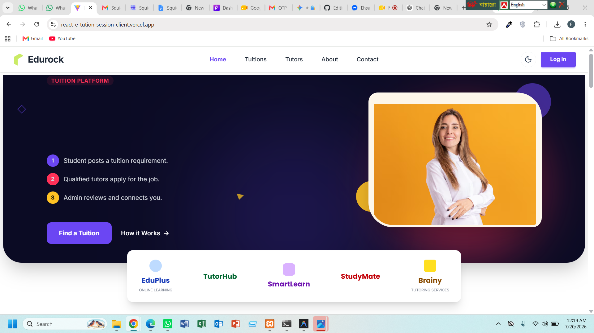

# Edurock Web

React 19 + Vite web app for **Edurock**, a tuition marketplace for Bangladesh. Students post tuition requests, tutors apply, families hire through Stripe, and admins moderate the platform.

**Stack:** React 19 · React Router 7 · TanStack Query 5 · Tailwind CSS 4 + daisyUI 5 · Firebase Auth · Stripe · Recharts · Headless UI · a **custom motion engine** (no animation libraries).

## Live demo

| Service | URL |
| --- | --- |
| Frontend | https://react-e-tution-session-client.vercel.app/ |
| Backend API | https://react-e-tution-session-sever.vercel.app/ |



```bash
cp .env.example .env    # VITE_API_URL, VITE_IMAGE_HOST_KEY
npm install
npm run dev             # http://localhost:5173
npm run build && npm run preview
npm run lint
```

Point `VITE_API_URL` at the API origin only (no `/api/v1` — the client adds it). Local default: `http://localhost:3000`.

## Features

- Firebase email/password, Google sign-in, and one-click demo accounts
- Role-based dashboards (Student, Tutor, Admin)
- Post, edit, and manage tuition requests
- Browse / filter tutors and tuitions; bookmark posts
- Tutor applications, hiring, and Stripe checkout
- Notifications, reviews, and in-app support chat
- Light / dark theme and a fully responsive layout

## Structure

```
src/
├── lib/motion/       Animation engine: ticker, easing, spring, animate, timeline, smoothScroll, scroll observers
├── motion/           React bindings: <Reveal>, <Stagger>, <TextReveal>, <Presence>, <Parallax>, <Magnetic>, <Tilt>, <CountUp>, <Marquee>…
├── api/              Axios client (token + envelope + errors) and endpoint/query-key registry
├── hooks/            React Query hooks (useApi), URL-synced filters, chart colours, document title
├── providers/        Auth (Firebase + profile sync), Theme (light/dark/system)
├── components/
│   ├── ui/           Design system: Button, Field inputs, Card, Badge, Avatar, Modal, DataTable, StatCard, skeletons…
│   ├── layout/       Navbar, Footer, Auth layout, notifications, user menu
│   ├── home/ tuition/ tutor/ dashboard/ charts/
├── layouts/          Main and dashboard shells
├── pages/            public/, auth/, dashboard/{common,student,tutor,admin}
├── routes/           Router (every page lazy-loaded), guards, skeleton fallbacks
└── styles/index.css  Design tokens and utilities
```

## Design system

- **Type:** Fraunces (serif display) for headings, Source Sans 3 for UI text.
- **Colour:** education teal primary and soft amber accent. Light and dark themes are daisyUI tokens, so components use semantic classes (`bg-base-100`, `text-primary`, `text-muted`) and switch automatically.
- **Utilities:** `container-page`, `text-muted` / `text-subtle`, `border-soft`, `bg-soft`, `glass`, `bg-dots`, `text-gradient`, `skeleton-shimmer`, `spotlight`.
- **Reusable patterns:** every data view has a skeleton, an error state with retry, and an empty state with a next step. `DataTable` renders a table on desktop and cards on phones from the same column config.

## Motion engine (replaces framer-motion, GSAP and Lenis)

| Piece | Like | API |
| --- | --- | --- |
| `ticker` | GSAP ticker | One shared `requestAnimationFrame` loop that only runs while something is animating |
| `animate()` | framer `animate` / GSAP `to` | `animate(el, { opacity: [0, 1], y: [24, 0] }, { duration, ease, stagger, spring })`. Animates transform parts independently and interrupts cleanly |
| `createSpring` | framer springs | Frame-rate-independent damped spring (1 ms sub-steps) |
| `timeline()` | GSAP timeline | `.to(target, props, opts, '-=0.3').play() / reverse() / seek() / progress()` |
| `SmoothScroll` | Lenis | Damped wheel scrolling over native scroll (sticky, anchors and keyboard all keep working). Turned off on touch devices and with reduced motion |
| `observeInView` / `observeProgress` | ScrollTrigger | Shared IntersectionObservers, plus scroll-linked 0→1 progress with `start` / `end` |
| `<Presence>` | AnimatePresence | Enter/exit animations for mounting and unmounting |

Every component reads `prefers-reduced-motion` and jumps straight to the final state when it is set. Motion never delays content.

## Performance

- Route-level code splitting (every page is its own chunk), long-lived vendor chunks (`react`, `firebase`, `charts`, `data`), and SweetAlert loaded on demand.
- React Query caching (60 s fresh, 10 min in memory), `keepPreviousData` for pagination, and prefetch on hover for tuition and tutor pages.
- Optimistic UI for bookmarks and notification read state.
- Lazy images with a fade-in and a fallback, a high-priority hero image, preconnect + `display=swap` fonts, and an inline theme script (no colour flash).
- Filters live in the URL: shareable, survive refresh, and work with back/forward. Search is debounced.
- Immutable caching headers for hashed assets (`vercel.json`).

## User roles

| Role | Can |
| --- | --- |
| Student | Post tuitions, review applicants, hire with Stripe, save posts, leave reviews |
| Tutor | Browse open tuitions, apply, manage ongoing bookings |
| Admin | Moderate tuitions, users, payments, contact messages, and support chats |

## Deploying (Vercel)

Import the repo, use the Vite preset, and add `VITE_API_URL` (your API origin) and `VITE_IMAGE_HOST_KEY`. Add the Vercel domain to the API’s `CLIENT_URL` / `CORS_ORIGINS`.

## Author

**Rimi** · [github.com/rimi-1234](https://github.com/rimi-1234)

This project is licensed under the MIT License.
